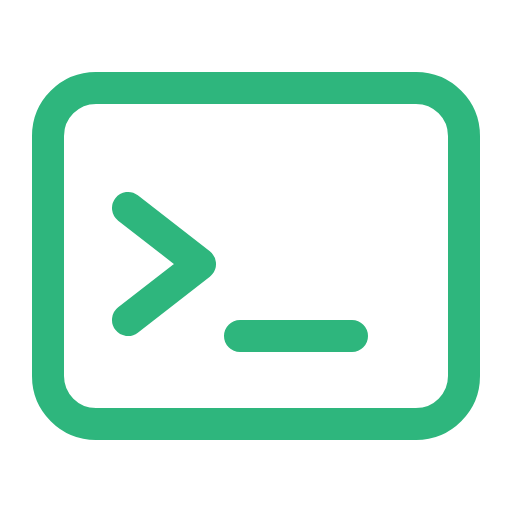

<p align="center"></p>

<h1 align="center">setup-iterm</h1>

<p align="center"><b>iTerm2 and Karabiner setup: a Quake-style hotkey window, tab keys, shell integration, a folder badge and a bootstrap snippet.</b></p>

<p align="center">
  
  
  
  
</p>

<p align="center">
  <a href="https://github.com/lawrence-berry/setup-iterm/actions/workflows/ci.yml"></a>
</p>

iTerm setup: the Quake-style window hotkey and the Karabiner shortcut that triggers it, tab-switching keys, shell integration, a folder-name badge, and a `bootstrapit` snippet.

## Supported versions

| Component | Version | Status |
|---|---|---|
| macOS | 27 (Apple Silicon) | Used daily |
| iTerm2 | 3.5+ (Snippets) | By hand |
| Karabiner-Elements | 16.3 | Installed by setup-mac's Brewfile |
| Shell | `/bin/sh` (POSIX); `badge.sh` is sourced by bash or zsh | ShellCheck in CI |

## Install

```sh
./install.sh
```

Run it from a shell outside iTerm (Terminal.app, say) with iTerm quit (⌘Q). iTerm rewrites its preferences and `snippets.plist` while it runs, so the profile background and snippets steps are skipped (and `defaults` changes can be overwritten) if it's open. Then open iTerm. Re-runnable.

- **Quake window**: turns on iTerm's "Show/hide all windows with a system-wide hotkey" (Settings → Keys → Hotkey) and sets it to ⌥\\. Your Default profile's window Style is "Top of Screen", so the window you have open drops down from the top. That Style isn't set by this repo: on a new Mac, set it once in Settings → Profiles → Window.
- **Tab switching**: ⌃⌥← previous tab, ⌃⌥→ next tab, added to iTerm's global key bindings. The built-in ⌘⇧[ / ⌘⇧] and ⌃Tab still work.
- **`karabiner.json`**: double-tap left ⌘ sends ⌥\\. Karabiner is only used for this one rule, so `install.sh` copies the whole file over `~/.config/karabiner/karabiner.json` (keeping the old one as `karabiner.json.bak`). Karabiner picks it up straight away.
- **Shell integration**: downloads iTerm's script if it's missing and adds one `# setup-iterm` line to `~/.zshrc` (or `~/.bashrc`) that sources it.
- **Badge** (`badge.sh`): the badge shows the current folder's name with an emoji picked from the name. Inside a Rails app with a `public/icon.png`, that icon is also set as the session's background image instead. It uses iTerm's session escape codes, so the Default profile isn't touched; set Settings → Profiles → Window → Background Image blend to taste. iTerm asks once to allow the background image change.
- **Snippets** (`snippets.plist`): one snippet, `bootstrapit`, which types the [setup](https://lawrence-berry.github.io/setup) one-liner into the current session, so it works when you SSH into a blank server. Use it from Edit → Snippets (hold ⌥ to edit before sending). macOS text replacements don't expand in a terminal, so this is the terminal-side equivalent. Like `karabiner.json`, the repo owns the whole file: `install.sh` copies it over iTerm's (keeping `snippets.plist.bak`) only when iTerm is closed. Add snippets by editing `snippets.plist` here, or copy iTerm's file back after adding one in Settings.

## Changing things

**The two halves share one key, ⌥\\.** If you change it, change it in both places: `to` in `karabiner.json` and the `Hotkey…` values in `install.sh`.

Karabiner itself is installed by setup-mac's Brewfile.

## Tests

CI lints the scripts with ShellCheck. The installer writes iTerm's preferences, which only exist on a Mac with iTerm installed, so it is checked by hand.

Part of the [`setup-*`](https://lawrence-berry.github.io/setup) family; on a blank machine, `curl -fsSL https://lawrence-berry.github.io/setup | sh` installs them all (setup-mac and setup-iterm on macOS only).
